# Hand-off graph

Who hands off to whom. Generated by `node tools/build-handoffs.mjs` from each agent's `## Hand-offs` section — edit the agent file, not this one. `tech-lead` can delegate to every agent (see its delegation map).

```mermaid
flowchart LR
  tech_lead[tech-lead<br/>orchestrator]
  accessibility_auditor[accessibility-auditor] --> react_specialist[react-specialist]
  accessibility_auditor[accessibility-auditor] --> test_automator[test-automator]
  analytics_engineer[analytics-engineer] --> data_engineer[data-engineer]
  analytics_engineer[analytics-engineer] --> data_scientist[data-scientist]
  analytics_engineer[analytics-engineer] --> growth_strategist[growth-strategist]
  analytics_engineer[analytics-engineer] --> react_specialist[react-specialist]
  architect_reviewer[architect-reviewer] --> backend_architect[backend-architect]
  architect_reviewer[architect-reviewer] --> code_reviewer[code-reviewer]
  backend_architect[backend-architect] --> postgres_pro[postgres-pro]
  backend_architect[backend-architect] --> security_auditor[security-auditor]
  backend_architect[backend-architect] --> architect_reviewer[architect-reviewer]
  backend_architect[backend-architect] --> graphql_specialist[graphql-specialist]
  backend_architect[backend-architect] --> prompt_engineer[prompt-engineer]
  brand_voice[brand-voice] --> content_marketer[content-marketer]
  brand_voice[brand-voice] --> seo_specialist[seo-specialist]
  ci_engineer[ci-engineer] --> test_automator[test-automator]
  ci_engineer[ci-engineer] --> docker_specialist[docker-specialist]
  ci_engineer[ci-engineer] --> dependency_auditor[dependency-auditor]
  code_reviewer[code-reviewer] --> debugger[debugger]
  code_reviewer[code-reviewer] --> security_auditor[security-auditor]
  code_reviewer[code-reviewer] --> refactorer[refactorer]
  competitive_analyst[competitive-analyst] --> growth_strategist[growth-strategist]
  competitive_analyst[competitive-analyst] --> brand_voice[brand-voice]
  content_marketer[content-marketer] --> brand_voice[brand-voice]
  content_marketer[content-marketer] --> seo_specialist[seo-specialist]
  conversion_optimizer[conversion-optimizer] --> analytics_engineer[analytics-engineer]
  conversion_optimizer[conversion-optimizer] --> data_scientist[data-scientist]
  conversion_optimizer[conversion-optimizer] --> content_marketer[content-marketer]
  conversion_optimizer[conversion-optimizer] --> react_specialist[react-specialist]
  css_specialist[css-specialist] --> react_specialist[react-specialist]
  css_specialist[css-specialist] --> accessibility_auditor[accessibility-auditor]
  css_specialist[css-specialist] --> performance_profiler[performance-profiler]
  customer_researcher[customer-researcher] --> product_manager[product-manager]
  customer_researcher[customer-researcher] --> content_marketer[content-marketer]
  customer_researcher[customer-researcher] --> pricing_strategist[pricing-strategist]
  customer_researcher[customer-researcher] --> sales_enablement[sales-enablement]
  data_engineer[data-engineer] --> postgres_pro[postgres-pro]
  data_engineer[data-engineer] --> python_pro[python-pro]
  data_engineer[data-engineer] --> analytics_engineer[analytics-engineer]
  data_engineer[data-engineer] --> ml_engineer[ml-engineer]
  data_scientist[data-scientist] --> ml_engineer[ml-engineer]
  data_scientist[data-scientist] --> data_engineer[data-engineer]
  data_scientist[data-scientist] --> analytics_engineer[analytics-engineer]
  data_scientist[data-scientist] --> conversion_optimizer[conversion-optimizer]
  debugger[debugger] --> test_automator[test-automator]
  debugger[debugger] --> code_reviewer[code-reviewer]
  dependency_auditor[dependency-auditor] --> migration_planner[migration-planner]
  dependency_auditor[dependency-auditor] --> security_auditor[security-auditor]
  dependency_auditor[dependency-auditor] --> ci_engineer[ci-engineer]
  devops_engineer[devops-engineer] --> security_auditor[security-auditor]
  devops_engineer[devops-engineer] --> kubernetes_specialist[kubernetes-specialist]
  devops_engineer[devops-engineer] --> ci_engineer[ci-engineer]
  devops_engineer[devops-engineer] --> observability_engineer[observability-engineer]
  docker_specialist[docker-specialist] --> ci_engineer[ci-engineer]
  docker_specialist[docker-specialist] --> security_auditor[security-auditor]
  go_pro[go-pro] --> rust_pro[rust-pro]
  go_pro[go-pro] --> performance_profiler[performance-profiler]
  go_pro[go-pro] --> backend_architect[backend-architect]
  go_pro[go-pro] --> test_automator[test-automator]
  graphql_specialist[graphql-specialist] --> postgres_pro[postgres-pro]
  graphql_specialist[graphql-specialist] --> security_auditor[security-auditor]
  graphql_specialist[graphql-specialist] --> typescript_pro[typescript-pro]
  growth_strategist[growth-strategist] --> content_marketer[content-marketer]
  growth_strategist[growth-strategist] --> competitive_analyst[competitive-analyst]
  incident_responder[incident-responder] --> debugger[debugger]
  incident_responder[incident-responder] --> observability_engineer[observability-engineer]
  incident_responder[incident-responder] --> release_manager[release-manager]
  incident_responder[incident-responder] --> kubernetes_specialist[kubernetes-specialist]
  kubernetes_specialist[kubernetes-specialist] --> docker_specialist[docker-specialist]
  kubernetes_specialist[kubernetes-specialist] --> devops_engineer[devops-engineer]
  kubernetes_specialist[kubernetes-specialist] --> observability_engineer[observability-engineer]
  kubernetes_specialist[kubernetes-specialist] --> incident_responder[incident-responder]
  migration_planner[migration-planner] --> architect_reviewer[architect-reviewer]
  migration_planner[migration-planner] --> refactorer[refactorer]
  migration_planner[migration-planner] --> test_automator[test-automator]
  migration_planner[migration-planner] --> release_manager[release-manager]
  ml_engineer[ml-engineer] --> data_scientist[data-scientist]
  ml_engineer[ml-engineer] --> data_engineer[data-engineer]
  ml_engineer[ml-engineer] --> python_pro[python-pro]
  ml_engineer[ml-engineer] --> observability_engineer[observability-engineer]
  mobile_specialist[mobile-specialist] --> typescript_pro[typescript-pro]
  mobile_specialist[mobile-specialist] --> accessibility_auditor[accessibility-auditor]
  mobile_specialist[mobile-specialist] --> performance_profiler[performance-profiler]
  mobile_specialist[mobile-specialist] --> release_manager[release-manager]
  node_pro[node-pro] --> typescript_pro[typescript-pro]
  node_pro[node-pro] --> performance_profiler[performance-profiler]
  node_pro[node-pro] --> backend_architect[backend-architect]
  node_pro[node-pro] --> security_auditor[security-auditor]
  observability_engineer[observability-engineer] --> incident_responder[incident-responder]
  observability_engineer[observability-engineer] --> performance_profiler[performance-profiler]
  observability_engineer[observability-engineer] --> devops_engineer[devops-engineer]
  observability_engineer[observability-engineer] --> security_auditor[security-auditor]
  performance_profiler[performance-profiler] --> postgres_pro[postgres-pro]
  performance_profiler[performance-profiler] --> refactorer[refactorer]
  postgres_pro[postgres-pro] --> backend_architect[backend-architect]
  postgres_pro[postgres-pro] --> performance_profiler[performance-profiler]
  pricing_strategist[pricing-strategist] --> competitive_analyst[competitive-analyst]
  pricing_strategist[pricing-strategist] --> customer_researcher[customer-researcher]
  pricing_strategist[pricing-strategist] --> analytics_engineer[analytics-engineer]
  pricing_strategist[pricing-strategist] --> content_marketer[content-marketer]
  product_manager[product-manager] --> tech_lead[tech-lead]
  product_manager[product-manager] --> architect_reviewer[architect-reviewer]
  product_manager[product-manager] --> customer_researcher[customer-researcher]
  product_manager[product-manager] --> analytics_engineer[analytics-engineer]
  prompt_engineer[prompt-engineer] --> ml_engineer[ml-engineer]
  prompt_engineer[prompt-engineer] --> test_automator[test-automator]
  prompt_engineer[prompt-engineer] --> security_auditor[security-auditor]
  python_pro[python-pro] --> test_automator[test-automator]
  python_pro[python-pro] --> typescript_pro[typescript-pro]
  react_specialist[react-specialist] --> accessibility_auditor[accessibility-auditor]
  react_specialist[react-specialist] --> typescript_pro[typescript-pro]
  react_specialist[react-specialist] --> test_automator[test-automator]
  react_specialist[react-specialist] --> css_specialist[css-specialist]
  react_specialist[react-specialist] --> mobile_specialist[mobile-specialist]
  refactorer[refactorer] --> test_automator[test-automator]
  refactorer[refactorer] --> code_reviewer[code-reviewer]
  release_manager[release-manager] --> ci_engineer[ci-engineer]
  release_manager[release-manager] --> technical_writer[technical-writer]
  release_manager[release-manager] --> incident_responder[incident-responder]
  release_manager[release-manager] --> migration_planner[migration-planner]
  rust_pro[rust-pro] --> go_pro[go-pro]
  rust_pro[rust-pro] --> performance_profiler[performance-profiler]
  rust_pro[rust-pro] --> security_auditor[security-auditor]
  rust_pro[rust-pro] --> test_automator[test-automator]
  sales_enablement[sales-enablement] --> competitive_analyst[competitive-analyst]
  sales_enablement[sales-enablement] --> brand_voice[brand-voice]
  sales_enablement[sales-enablement] --> pricing_strategist[pricing-strategist]
  sales_enablement[sales-enablement] --> customer_researcher[customer-researcher]
  security_auditor[security-auditor] --> backend_architect[backend-architect]
  security_auditor[security-auditor] --> code_reviewer[code-reviewer]
  security_auditor[security-auditor] --> smart_contract_auditor[smart-contract-auditor]
  security_auditor[security-auditor] --> dependency_auditor[dependency-auditor]
  seo_specialist[seo-specialist] --> content_marketer[content-marketer]
  seo_specialist[seo-specialist] --> brand_voice[brand-voice]
  smart_contract_auditor[smart-contract-auditor] --> security_auditor[security-auditor]
  smart_contract_auditor[smart-contract-auditor] --> test_automator[test-automator]
  smart_contract_auditor[smart-contract-auditor] --> architect_reviewer[architect-reviewer]
  technical_writer[technical-writer] --> code_reviewer[code-reviewer]
  technical_writer[technical-writer] --> content_marketer[content-marketer]
  technical_writer[technical-writer] --> brand_voice[brand-voice]
  test_automator[test-automator] --> debugger[debugger]
  test_automator[test-automator] --> ci_engineer[ci-engineer]
  typescript_pro[typescript-pro] --> react_specialist[react-specialist]
  typescript_pro[typescript-pro] --> refactorer[refactorer]
  typescript_pro[typescript-pro] --> node_pro[node-pro]
```

| Agent | Hands off to |
|---|---|
| `accessibility-auditor` | `react-specialist` (implements the fixes); `test-automator` (adds regression tests for the failing flows) |
| `analytics-engineer` | `data-engineer` (when the fix is in the warehouse model or pipeline); `data-scientist` (for experiment analysis and significance); `growth-strategist` (when the metrics reveal a funnel constraint to act on); `react-specialist` (for implementing the tracking calls in UI code) |
| `architect-reviewer` | `backend-architect` (revises the design if rejected); `code-reviewer` (reviews the implementation once approved) |
| `backend-architect` | `postgres-pro` (schema/index/migration detail); `security-auditor` (before shipping auth, payments or user data); `architect-reviewer` (for a second opinion on a hard tradeoff); `graphql-specialist` (when the API is GraphQL); `prompt-engineer` (when the service wraps an LLM call) |
| `brand-voice` | `content-marketer` (when copy needs rewriting, not just flagging); `seo-specialist` (when voice conflicts with search intent) |
| `ci-engineer` | `test-automator` (for flaky or missing tests behind a failing gate); `docker-specialist` (for slow or bloated image builds); `dependency-auditor` (to add dependency audit checks to the pipeline) |
| `code-reviewer` | `debugger` (for a reproducible failure found in review); `security-auditor` (when the diff touches auth, payments or input handling); `refactorer` (for structural issues that are not bugs) |
| `competitive-analyst` | `growth-strategist` (to turn findings into a positioning decision); `brand-voice` (to check claims against the established voice) |
| `content-marketer` | `brand-voice` (to check consistency before publishing); `seo-specialist` (for search-intent alignment) |
| `conversion-optimizer` | `analytics-engineer` (to define and verify the events the test depends on); `data-scientist` (for the significance analysis); `content-marketer` (to draft the variant copy once the hypothesis is set); `react-specialist` (to implement the variant behind a flag) |
| `css-specialist` | `react-specialist` (when the problem is component structure or state); `accessibility-auditor` (for focus, contrast, and reflow checks); `performance-profiler` (when layout shift or paint cost is the symptom) |
| `customer-researcher` | `product-manager` (to turn findings into a scoped spec); `content-marketer` (for the customer's own language in copy); `pricing-strategist` (for willingness-to-pay signals); `sales-enablement` (for the real objections behind sales materials) |
| `data-engineer` | `postgres-pro` (when the source or sink is a Postgres tuning problem); `python-pro` (for the packaging and typing of pipeline code); `analytics-engineer` (when the consumer is a dashboard or tracking plan); `ml-engineer` (when the output feeds a training or serving path) |
| `data-scientist` | `ml-engineer` (when the analysis should become a production model); `data-engineer` (when the data needs a reliable pipeline); `analytics-engineer` (when the metric definitions or tracking are the problem); `conversion-optimizer` (when the question is about an A/B test on a funnel) |
| `debugger` | `test-automator` (to lock the fix in with a regression test); `code-reviewer` (to review the fix diff) |
| `dependency-auditor` | `migration-planner` (when the fix is a major-version or framework upgrade); `security-auditor` (when a vulnerable path handles untrusted input); `ci-engineer` (to add audit and lockfile checks to the pipeline) |
| `devops-engineer` | `security-auditor` (for IAM scope, public exposure, and secrets handling); `kubernetes-specialist` (when the target is a cluster workload); `ci-engineer` (to gate the pipeline that applies the change); `observability-engineer` (to add alerts for the resources provisioned) |
| `docker-specialist` | `ci-engineer` (to wire image builds into the pipeline); `security-auditor` (for secrets or privilege concerns) |
| `go-pro` | `rust-pro` (when memory control or zero-cost abstractions are the requirement); `performance-profiler` (for pprof-driven optimization); `backend-architect` (when the question is service boundaries, not Go); `test-automator` (for table-driven and integration tests) |
| `graphql-specialist` | `postgres-pro` (when batched resolvers still produce slow queries); `security-auditor` (for field-level authorization and query-cost abuse); `typescript-pro` (for generated types and resolver typing) |
| `growth-strategist` | `content-marketer` (to execute the chosen channel); `competitive-analyst` (for evidence on alternatives) |
| `incident-responder` | `debugger` (for root-cause analysis once service is restored); `observability-engineer` (to close the detection gap the incident exposed); `release-manager` (for rollback and rollout process fixes); `kubernetes-specialist` (when the failing layer is the cluster) |
| `kubernetes-specialist` | `docker-specialist` (for image size, build, and base image issues); `devops-engineer` (for the cluster and cloud resources underneath); `observability-engineer` (for dashboards and alerts on the workload); `incident-responder` (when a live outage is in progress) |
| `migration-planner` | `architect-reviewer` (to review the target design before committing to it); `refactorer` (for behavior-preserving prep work before the migration); `test-automator` (for characterization tests that guard the migration); `release-manager` (for rollout sequencing and flags) |
| `ml-engineer` | `data-scientist` (for exploratory analysis and hypothesis checks); `data-engineer` (for the feature pipeline and backfills); `python-pro` (for packaging the training and serving code); `observability-engineer` (for drift and input monitoring in production) |
| `mobile-specialist` | `typescript-pro` (for complex shared types across native and JS); `accessibility-auditor` (for screen-reader and dynamic-type checks); `performance-profiler` (for jank, startup time, or memory); `release-manager` (for store builds, versioning, and phased rollout) |
| `node-pro` | `typescript-pro` (for types across the service boundary); `performance-profiler` (for flame graphs and leak hunting); `backend-architect` (when the question is API or service design); `security-auditor` (for input handling and dependency exposure) |
| `observability-engineer` | `incident-responder` (when an alert indicates a live outage); `performance-profiler` (when traces show a slow path that needs profiling); `devops-engineer` (for the alerting infrastructure itself); `security-auditor` (when logs may contain sensitive data) |
| `performance-profiler` | `postgres-pro` (when the bottleneck is a query); `refactorer` (when the fix is structural) |
| `postgres-pro` | `backend-architect` (when the schema problem is really an API design problem); `performance-profiler` (to confirm the slow path before indexing) |
| `pricing-strategist` | `competitive-analyst` (for sourced competitor pricing); `customer-researcher` (for willingness-to-pay evidence); `analytics-engineer` (for the usage data the value metric depends on); `content-marketer` (for the pricing page once the decision is made) |
| `product-manager` | `tech-lead` (to decompose the finished spec into delegated work); `architect-reviewer` (to pressure-test a spec with a costly design decision); `customer-researcher` (to ground the problem in real user evidence); `analytics-engineer` (to define how success will be measured) |
| `prompt-engineer` | `ml-engineer` (when the failure needs data or fine-tuning, not wording); `test-automator` (to turn the case set into a regression test in CI); `security-auditor` (for prompt injection through untrusted inputs) |
| `python-pro` | `test-automator` (for test coverage on new modules); `typescript-pro` (when the same contract must match a TS client) |
| `react-specialist` | `accessibility-auditor` (before shipping user-facing UI); `typescript-pro` (for complex generic or prop typing); `test-automator` (for component tests); `css-specialist` (for layout, stacking, and responsive bugs); `mobile-specialist` (when the target is React Native instead of web) |
| `refactorer` | `test-automator` (to pin behaviour before restructuring); `code-reviewer` (to confirm behaviour is preserved) |
| `release-manager` | `ci-engineer` (for the build and publish pipeline); `technical-writer` (for upgrade guides on breaking releases); `incident-responder` (when a release goes wrong in production); `migration-planner` (when the release carries a staged migration) |
| `rust-pro` | `go-pro` (when the service belongs in Go instead); `performance-profiler` (to measure before hand-optimizing); `security-auditor` (for any `unsafe` or FFI boundary); `test-automator` (for property or integration tests) |
| `sales-enablement` | `competitive-analyst` (for sourced competitor facts to put in a battlecard); `brand-voice` (to check claims and tone before the asset ships); `pricing-strategist` (when the objection is really about price or packaging); `customer-researcher` (for the real buyer language behind the objections) |
| `security-auditor` | `backend-architect` (when the fix is a design change); `code-reviewer` (for non-security findings noticed along the way); `smart-contract-auditor` (for EVM contracts that hold or move value); `dependency-auditor` (for vulnerable or risky third-party packages) |
| `seo-specialist` | `content-marketer` (to rewrite pages for search intent); `brand-voice` (to keep optimized copy on voice) |
| `smart-contract-auditor` | `security-auditor` (for the off-chain backend and key handling around the contract); `test-automator` (for invariant and fork tests that lock in the fixes); `architect-reviewer` (when the issue is the design (privilege model, upgrade path)) |
| `technical-writer` | `code-reviewer` (when writing docs exposes behavior that looks like a bug); `content-marketer` (when the page is really a pitch, not documentation); `brand-voice` (to check docs against an established voice guide) |
| `test-automator` | `debugger` (when a new test exposes a real bug); `ci-engineer` (to enforce the tests as a merge gate) |
| `typescript-pro` | `react-specialist` (for component API design); `refactorer` (for large type-driven restructures); `node-pro` (when the problem is Node runtime behavior, not types) |
